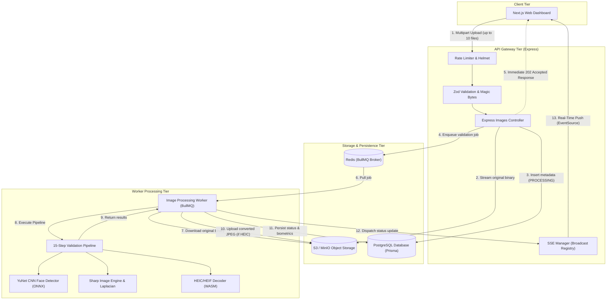

# System Architecture & Technical Design

## 1. Overview & Architectural Principles

The Image Upload & Validation Platform is architected as an asynchronous, event-driven, decoupled system built inside a Turborepo monorepo with pnpm. The platform adheres strictly to Clean Architecture principles:
- **Presentation Layer (Web)**: Next.js App Router, Tailwind CSS, TanStack Query, and React Hooks.
- **API Transport Layer (Express)**: Handles routing, security, rate limiting, and HTTP dispatch without encapsulating business logic.
- **Domain Services & Repositories**: Pure business logic and database abstractions.
- **Asynchronous Worker Engine**: Standalone BullMQ workers executing compute-intensive image processing pipelines outside the HTTP request lifecycle.
- **Infrastructure Adapters**: Decoupled S3/MinIO storage clients, PostgreSQL Prisma repositories, and Redis queues.

---

## 2. System Architecture Diagram



---

## 3. Monorepo Organization

```
image-val/
├── apps/
│   ├── api/                     # Express REST API & Standalone Background Worker
│   │   ├── src/
│   │   │   ├── config/          # Environment & Swagger OpenAPI configuration
│   │   │   ├── infrastructure/  # Storage (S3/MinIO), Queue (BullMQ), Database, Logger (Pino)
│   │   │   ├── middleware/      # Rate limiter, Request-ID, Error handler, Zod validation
│   │   │   ├── modules/
│   │   │   │   ├── images/      # Images controller, service, repository, routes
│   │   │   │   └── health/      # Health check probes (/health/live, /health/ready)
│   │   │   ├── utils/           # Server-Sent Events (SSE) Manager
│   │   │   ├── workers/         # Dedicated BullMQ Image Processor Worker
│   │   │   └── index.ts         # Server entry point
│   │   └── test/                # Supertest API & S3 adapter test suites
│   │
│   └── web/                     # Next.js 14 App Router Frontend Dashboard
│       ├── src/
│       │   ├── app/             # App Router layout, page, providers, globals.css
│       │   ├── components/      # Dropzone, QueueList, ImageCard, Grid, DetailModal
│       │   ├── hooks/           # useImageUpload, useImages, useImageEvents (SSE)
│       │   ├── lib/             # Utility helpers (cn, formatBytes, formatDate)
│       │   ├── services/        # Client-side API client with XHR progress tracking
│       │   └── types/           # UI state interfaces
│       └── test/                # Frontend validation unit tests
│
├── packages/
│   ├── shared/                  # Common TypeScript schemas, enums, types, limits
│   │   ├── src/
│   │   │   ├── constants/       # File size, dimension, and threshold constants
│   │   │   ├── schemas/         # Zod schemas for env, query, and pagination
│   │   │   └── types/           # Shared domain models & event payloads
│   │
│   ├── database/                # Prisma ORM schema, migrations, and client
│   │   ├── prisma/
│   │   │   ├── migrations/      # Production SQL migration files
│   │   │   └── schema.prisma    # Image, ValidationResultRecord, ProcessingAttempt
│   │   └── src/index.ts         # Client singleton with lazy connection
│   │
│   └── image-processing/        # Pure algorithmic validation engine
│       ├── models/              # OpenCV YuNet ONNX face detection model
│       ├── src/
│       │   ├── converters/      # HEIC/HEIF decoder & JPEG converter
│       │   ├── detectors/       # Laplacian blur, YuNet face detector, pHash/dHash
│       │   ├── pipeline/        # 15-stage modular orchestrator
│       │   └── validators/      # Magic bytes format, file size, resolution
│       └── test/                # Real fixture-based test suites (36 tests)
```

---

## 4. Key Subsystem Implementations

### A. Object Storage Layer (`apps/api/src/infrastructure/storage`)
- Implements `ObjectStorage` interface wrapping `@aws-sdk/client-s3` and `@aws-sdk/s3-request-presigner`.
- Works transparently with Amazon S3 or self-hosted MinIO via `S3_FORCE_PATH_STYLE="true"` and endpoint overrides.
- Private bucket design: Objects are never publicly readable. All previews use time-limited HMAC-signed URLs (1 hour expiration).
- Key partitioning:
  - `originals/${uuid}.${ext}`
  - `processed/${uuid}.jpeg`

### B. Asynchronous Job Processing (`apps/api/src/workers`)
- BullMQ queue `image-validation` powered by Redis.
- Configurable worker concurrency (`WORKER_CONCURRENCY=3`).
- Idempotent execution using `jobId: imageId`.
- Exponential backoff retry strategy (`delay: 2000 * 2^attempts`, 3 attempts).
- Dead-letter handling: marks image as `FAILED` in PostgreSQL and audits the error stack.

### C. Real-Time Status Notification (`apps/api/src/utils/sse-manager.ts`)
- Server-Sent Events (SSE) streaming endpoint `/api/v1/images/events`.
- Heartbeat pings every 15 seconds to prevent NAT/proxy disconnection.
- Auto-reconnect with exponential backoff on the Next.js frontend.
- Live cache invalidation on `@tanstack/react-query`.
